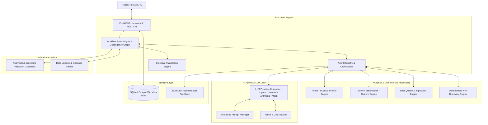

# AI Data Analyst OS — System Architecture

## Overview
**AI Data Analyst OS** is a production-grade, multi-agent business intelligence, data science, and consulting platform. It accepts structured datasets (CSV/Excel) alongside natural language business objectives, autonomously profiles data, plans analytical tasks, computes deterministic statistics & KPIs, engineers features, conducts machine learning / statistical segmentation, validates claims against evidence, and delivers executive storytelling and recommendations.

## System Architecture Diagram

## Key Architectural Principles

1. **Analytical Dependency Graph (DAG)**:
   - Workflows are represented as explicit directed acyclic graphs of nodes.
   - Each node contains: ID, Agent, Input Artifacts, Output Artifacts, Parameters, Execution Status, Token/Cost metrics, Model info, Version, Dependencies, and Validation status.

2. **Human-In-The-Loop (HITL) with Selective Invalidation**:
   - Analysts can modify any upstream decision (e.g. Imputation strategy, Outlier threshold, Model parameters).
   - Changing a decision does NOT rerun the whole pipeline. The dependency graph invalidates strictly downstream dependent nodes while preserving unaffected nodes.

3. **Deterministic Computation First**:
   - Statistical metrics, correlation matrices, distributions, missing percentages, and group aggregations are calculated directly using Polars/DuckDB/Pandas/Scikit-learn.
   - LLMs receive compact, structured summaries instead of raw CSV dumps to minimize cost, speed up execution, and prevent hallucinations.

4. **Claim Validation Guardrails**:
   - Insights and recommendations are validated against calculated evidence artifacts prior to display.
   - Unsupported statements, causal overreach (claiming X caused Y without experiment design), or data leakage are flagged automatically.
